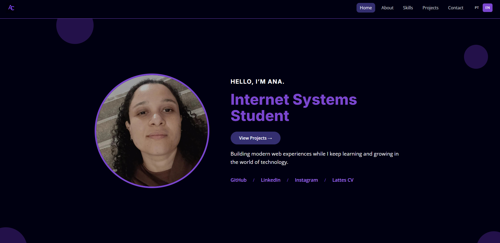

# Portfólio | Ana Cristina Brito

Portfólio pessoal responsivo e bilíngue (PT/EN), desenvolvido com HTML, CSS e JavaScript puros. Apresenta quem eu sou, minhas habilidades, meus projetos e um formulário de contato funcional.

**Acesse online:** https://anacrisbrito.github.io/Meu-portfolio/



---

## Sobre o projeto

Sou estudante de Sistemas para Internet na UEG e criei este portfólio para reunir meus projetos e mostrar minha evolução na área de tecnologia. O foco foi construir uma página rápida, acessível e fácil de manter, sem frameworks nem etapa de build.

## Funcionalidades

- **Site bilíngue (PT/EN):** o botão de idioma traduz a página inteira, incluindo textos, descrições, `alt` das imagens, placeholders e mensagens do formulário. A escolha fica salva no navegador.
- **Design responsivo:** layout adaptado para desktop, tablet e celular, com menu suspenso no mobile.
- **Navegação inteligente:** o menu destaca a seção que está na tela e a rolagem entre seções é suave.
- **Formulário de contato:** envio de e-mails diretamente do site com [EmailJS](https://www.emailjs.com/), com validação e retorno visual de sucesso ou erro.
- **Acessibilidade:** link "pular para o conteúdo", foco visível no teclado, atributos ARIA, HTML semântico e respeito à preferência por menos movimento.
- **Sem dependências de build:** basta abrir o `index.html`.

## Tecnologias

| Tecnologia | Uso |
| --- | --- |
| HTML5 | Estrutura semântica |
| CSS3 | Estilo, variáveis CSS, Grid, Flexbox e responsividade |
| JavaScript (ES6+) | Tradução, menu mobile, seção ativa e envio do formulário |
| EmailJS | Envio de e-mails sem back-end |
| Google Fonts | Tipografias Inter e Open Sans |

## Estrutura de pastas

```
Meu-portfolio/
├── index.html
├── style.css
├── script.js
├── README.md
└── assets/
    ├── icons/            # Ícones de tecnologias e favicon
    ├── logo/             # Logo
    ├── preview/          # Print usado no README
    ├── minhas_fotos/     # Fotos de perfil
    └── prints_projetos/  # Prévias dos projetos
```

## Como executar localmente

1. Clone o repositório:

   ```bash
   git clone https://github.com/AnaCrisBrito/Meu-portfolio.git
   ```

2. Entre na pasta do projeto:

   ```bash
   cd Meu-portfolio
   ```

3. Abra o `index.html` no navegador. Se preferir, use a extensão **Live Server** do VS Code, que recarrega a página automaticamente.

## Projetos em destaque

| Projeto | Descrição | Tecnologias |
| --- | --- | --- |
| [VeloDash](https://github.com/AnaCrisBrito/velodash) | Dashboard analítico interativo para métricas operacionais e financeiras | Python, Streamlit |
| [BlackJack](https://github.com/AnaCrisBrito/Blackjack) | Jogo de cartas "21" no navegador | HTML, CSS, JavaScript |
| [Calculadora de IMC](https://github.com/AnaCrisBrito/Calculadora-de-IMC-com-HTML-CSS-e-JavaScript) | Cálculo de IMC em tempo real com feedback visual | HTML, CSS, JavaScript |
| [Relógio com JS](https://github.com/AnaCrisBrito/Relogio-com-JS) | Relógio dinâmico atualizado a cada segundo | HTML, CSS, JavaScript |

## Próximos passos

- [ ] Adicionar novos projetos na seção de portfólio
- [ ] Incluir novas tecnologias na seção de habilidades
- [ ] Adicionar o idioma espanhol

## Contato

- **E-mail:** anacrisbrito12@gmail.com
- **GitHub:** [AnaCrisBrito](https://github.com/AnaCrisBrito)
- **LinkedIn:** [anacristinabrito](https://www.linkedin.com/in/anacristinabrito/)
- **Instagram:** [@ana_crisbrito](https://www.instagram.com/ana_crisbrito/)
- **Lattes:** [Currículo Lattes](http://lattes.cnpq.br/6312829985656811)

---

Feito por **Ana Cristina Brito de Miranda**.